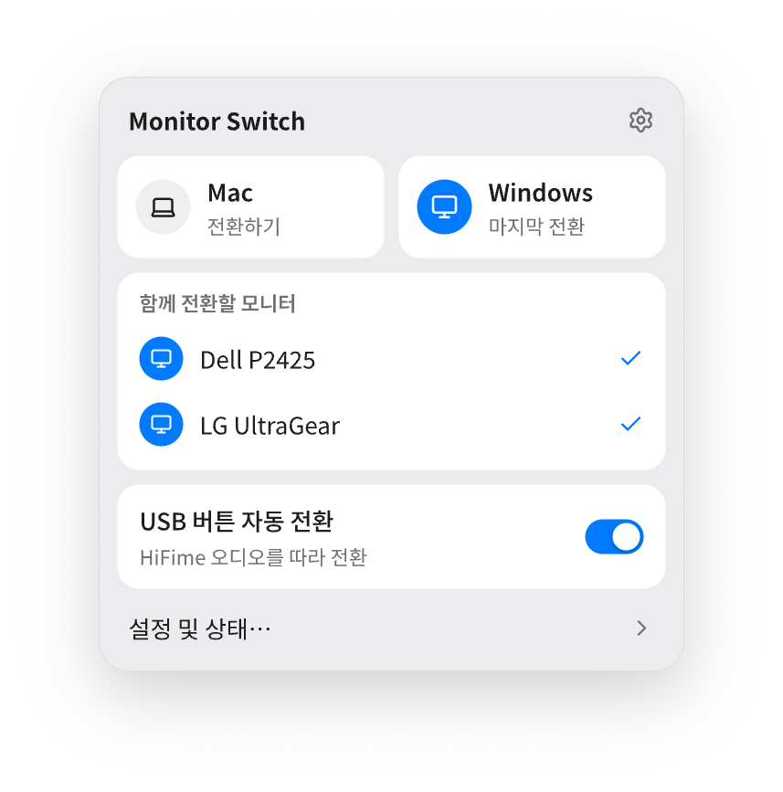

# 디자인

- [monitor-switch.pen](monitor-switch.pen): pen.dev에서 여는 편집용 UI 원본입니다.
- [previews](previews): 원본의 퀵 패널·앱 화면·컨텍스트 메뉴와 초기 적용 화면입니다.
- [applied-v2](applied-v2): 디자인을 앱에 적용했을 당시의 데모 화면입니다.
- [app-icon/monochrome](app-icon/monochrome): 최종 아이콘 원본, 제작 프롬프트, macOS 표시 예시입니다. 배포용 PNG·ICNS는 [assets/app](../assets/app)에 있습니다.

화면의 입력값은 디자인 예시입니다. 실제 연결 설정은 앱에서 지정하세요.

